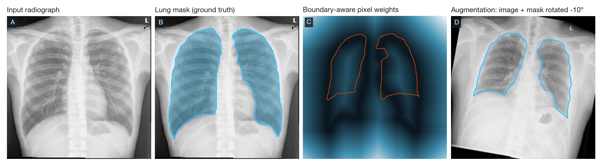
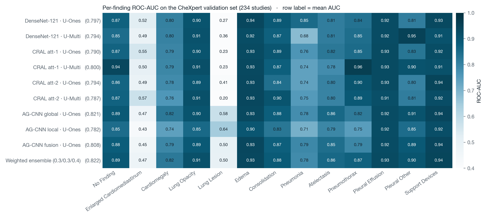
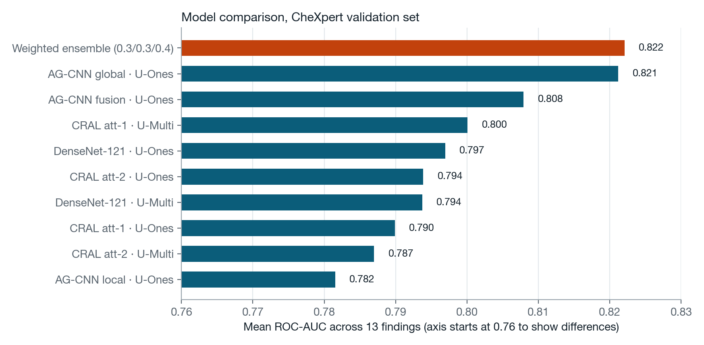

# Multi-task chest X-ray analysis: lung segmentation and thoracic findings

Research code from my work as an AI researcher at Universidad Tecnológica de Pereira (2021–2023), part of a line of work presented at IEEE EMBC.

*A: Shenzhen chest radiograph (public, de-identified). B: its manual lung mask. C: the boundary-aware weight map computed from a mask; low values (dark) sit on the lung border, so the segmentation loss can treat contour pixels differently from the background. D: the training-time augmentation, where image and mask are rotated together by −10°.*

## Problem

Chest X-ray classifiers can learn shortcuts outside the lungs, such as text markers, devices or patient positioning. Pixel-level lung labels exist for only a few hundred images, but image-level finding labels exist for tens of thousands. The aim was a single network that learns both tasks: segmenting the lungs and classifying thoracic findings, so the segmentation branch pushes the shared encoder towards anatomically relevant regions.

## My contribution

- Built the data pipeline that merges a large image-level labelled set with the 704 lung masks (Montgomery + Shenzhen) into sharded **TFRecords**. Each sample carries per-task flags (`w_label`, `w_segm`), so one batch can mix fully and partially labelled images.
- Designed **boundary-aware pixel weights** from each mask, using a morphological gradient and an L1 distance transform (panel C).
- Implemented hybrid encoder–decoder networks: a **DenseNet-121 + U-Net** decoder with a Dice loss, and a lighter **MobileNet** multi-task model with classification, segmentation and reconstruction heads. I also explored uncertainty-based loss weighting with learnable log-variances.
- Benchmarked classification backbones and uncertainty-label policies on the CheXpert validation set.

## Data

| Source | Use | Size documented in the notebooks |
|---|---|---|
| Merged CXR metadata (14 ChestX-ray14-style findings) | classification labels | 92,028 rows; 34,898 samples in TFRecords → 27,918 train / 3,490 val / 3,490 test |
| Montgomery + Shenzhen lung masks | segmentation labels | 704 masks |
| Shenzhen TB set with masks | MobileNet multi-task experiment | 80/20 split (`random_state=18`); 452 training images, doubled to 904 by rotation |
| CheXpert validation set | model comparison | 234 studies, 13 findings with positives |

The datasets are public and are not redistributed here. Paths in the notebooks point to the original Google Drive and Kaggle locations.

## Results

*Per-finding ROC-AUC for ten model variants on the 234-study CheXpert validation set. "U-Ones" and "U-Multi" are two ways of handling CheXpert's uncertain labels: mapping them to positive, or treating them as a separate class. Lung Lesion and Enlarged Cardiomediastinum stay near or below chance for most models, which is consistent with very few positive cases in this small validation set.*

| Model | Mean ROC-AUC (13 findings) |
|---|---|
| Weighted ensemble (0.3 CRAL att-1 U-Multi + 0.3 CRAL att-2 U-Multi + 0.4 AG-CNN global) | **0.822** |
| AG-CNN, global branch, U-Ones | 0.821 |
| DenseNet-121, U-Ones (baseline) | 0.797 |

Evaluation conditions: AUC is computed per finding with `sklearn.metrics.roc_auc_score` and averaged without weighting. The CheXpert validation split is used as a held-out set, and the ensemble weights were set by hand. There is no confidence interval: with 234 studies, differences of about 0.01 between models should not be read as significant.

## Notebooks

| Notebook | What it does |
|---|---|
| [`01_tfrecord_dataset_and_boundary_weights`](notebooks/01_tfrecord_dataset_and_boundary_weights.ipynb) | Mask loading, boundary-weight maps, TFRecord serialisation |
| [`02_train_hybrid_densenet_unet`](notebooks/02_train_hybrid_densenet_unet.ipynb) | TFRecord reader, Dice loss, DenseNet + U-Net training loop with checkpoints |
| [`03_mobilenet_multitask_gradcam`](notebooks/03_mobilenet_multitask_gradcam.ipynb) | MobileNet three-head model, augmentation, uncertainty-weighted multi-loss |
| [`04_chexpert_model_comparison`](notebooks/04_chexpert_model_comparison.ipynb) | Per-finding AUC tables, ROC curves and ensembling on CheXpert |

## Limitations and honest notes

- Segmentation Dice scores are **not** in these notebooks, so they are not reported here.
- In notebook 03, the Grad-CAM cell builds its gradient model from the ImageNet MobileNet (`predictions`, 1000 classes) rather than from the trained classifier. The heatmap therefore does not explain the TB model, and it is left out of the figures above. Fixing it means pointing `grad_model` at the trained network's `classification` output.
- Notebook 04 evaluates prediction files (`output/preds/*.npy`) produced by earlier training runs. Those files are not included.

## Stack
Python · TensorFlow/Keras · OpenCV · scikit-learn · NumPy/pandas · Google Colab (GPU) · Kaggle
