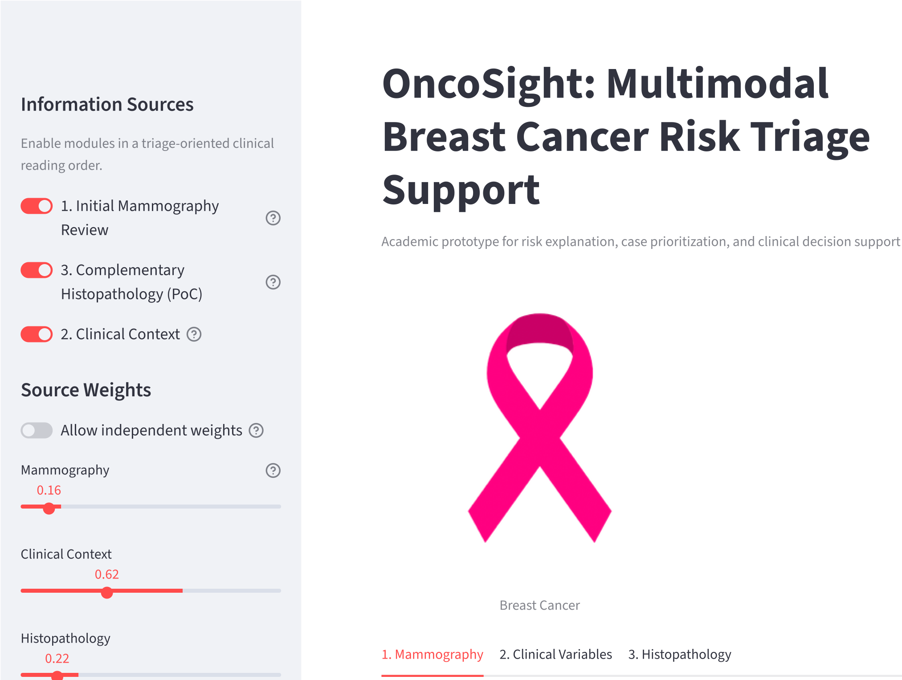
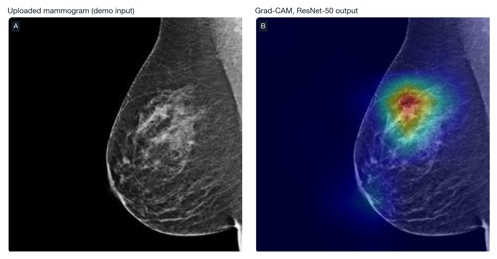
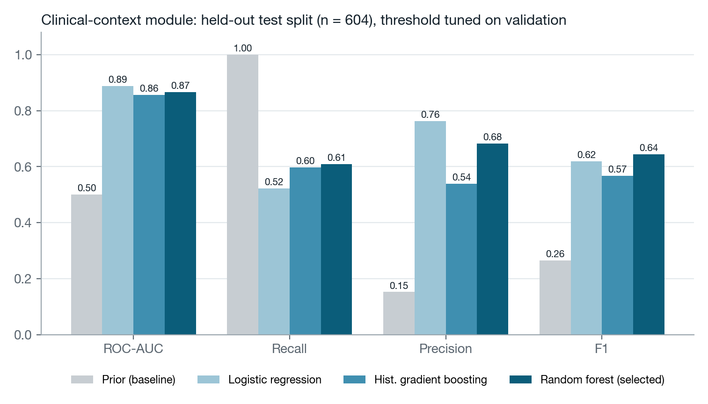
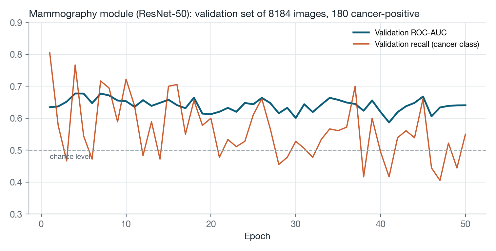
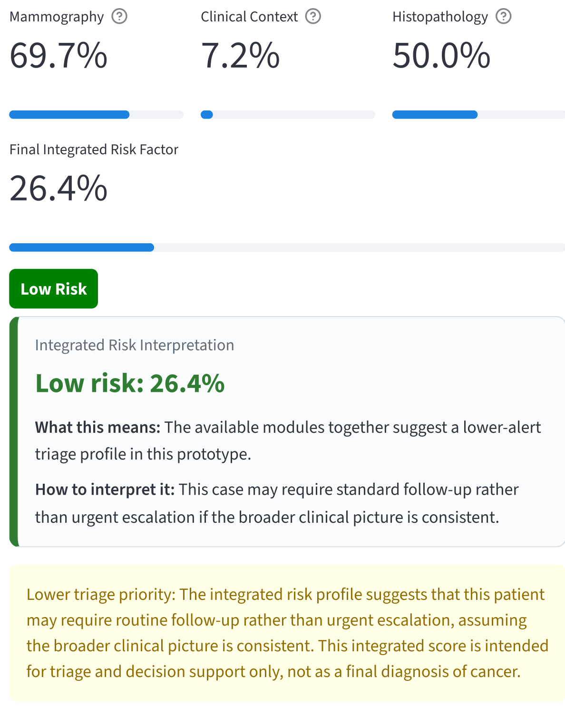

# OncoSight: multimodal breast cancer triage support (academic prototype)

A Streamlit decision-support prototype. It combines three independent models (mammography, clinical variables and histopathology) into one explained triage score.

> **Not a medical device.** OncoSight is an academic demonstration. It has not been clinically validated and must not be used for diagnosis or patient care.



*The sidebar sets which information sources are active and their fusion weights. Modules follow a triage-oriented reading order: mammography first, then clinical context, then histopathology.*

## Problem

Breast cancer work-ups draw on heterogeneous evidence, and each source arrives at a different point in the clinical pathway. The prototype explores how separately trained models can be combined transparently. The design rules were:

- every module reports its own probability and a plain-language interpretation;
- the integrated score is a weighted late fusion that the user can inspect;
- if a module is switched off, its weight is redistributed across the remaining ones and never silently treated as zero risk.

## My contribution

- Trained and exported all three models, and wrote the Streamlit application (`app/`): input handling (PNG, JPEG and DICOM via `pydicom`), per-module interpretation text, Grad-CAM overlays and the fusion logic.
- Implemented `weighted_late_fusion` (`app/modules/fusion.py`), with weight redistribution and Low (< 0.30), Moderate (≤ 0.60) and High risk bands.
- Wrote the clinical-safety copy: what each score means, how to read it, and its limits.

## Modules, data and documented performance

| Module | Data | Model | Documented result (from `app/models/*/metrics.json`) |
|---|---|---|---|
| Mammography | RSNA Screening Mammography | ResNet-50, ImageNet initialisation, Grad-CAM | Validation ROC-AUC **0.641**, recall 0.55, precision 0.03 (8,184 images, 180 cancer-positive) |
| Clinical context | SEER breast cancer cohort (tabular) | Class-balanced random forest, selected over logistic regression and gradient boosting | Test ROC-AUC **0.866**, recall 0.61, precision 0.68, F1 0.64 (n = 604; threshold 0.48 tuned on validation) |
| Histopathology (proof of concept) | PatchCamelyon (PCam) lymph-node patches | Small CNN, 96×96 patches | Trained; held-out metrics were not exported, so none are claimed |



*Screenshot from the recorded walkthrough. Left: the uploaded demo mammogram. Right: the Grad-CAM map for the ResNet-50 output, showing the region that contributed most to the 69.7% suspicious-features probability. It is a qualitative check on where the model looks, not proof that the model is correct.*



*Clinical-context module on the held-out test split. All candidates use class-balanced training, and each threshold was chosen on the validation split before testing. A prior-only baseline is included so the gain over chance is visible.*



*Mammography module: validation ROC-AUC stays between 0.59 and 0.68 over 50 epochs, and cancer-class recall swings widely. Only about 2% of validation images are positive. This is the main weakness of the prototype. Better image resolution, cropping to the breast region and a patient-level evaluation are the next steps.*



*Integrated summary for one demo case: per-module probabilities, the final weighted score and its interpretation. With the weights shown (0.16 / 0.62 / 0.22), the strong mammography signal is outweighed by a low clinical-context risk. The interface makes that trade-off explicit to the reader.*

## Honest notes

- The three cohorts are **unmatched**: no patient has all three modalities. The fusion shows how scores can be combined, but it has not been validated as a combined clinical model.
- An RSNA *metadata* random forest (ROC-AUC 0.998) is kept in `metrics.json` for transparency. It uses BI-RADS, biopsy and invasive-status fields that are only known after diagnostic work-up, which is label leakage. It is **not** used by the app or claimed as a result.
- The SEER module predicts a prognostic-risk label from clinical variables. It does not detect cancer.

## Run locally

```bash
python3.11 -m venv .venv && source .venv/bin/activate
pip install -r app/requirements.txt
streamlit run run_app.py
```

Model weights (about 134 MB: `rsna_resnet50_imagenet.pt`, `pcam_small_cnn_h5.pt` and the SEER `.joblib` files) are kept out of git. Place them in `app/models/{rsna,pcam,seer}/`. The app looks for them by name and shows a status message if a model is missing. A full walkthrough is in [`docs/oncosight_demo_walkthrough.pdf`](docs/oncosight_demo_walkthrough.pdf).

## Stack
Python · PyTorch/torchvision · scikit-learn · Streamlit · pytorch-grad-cam · pydicom · Plotly
