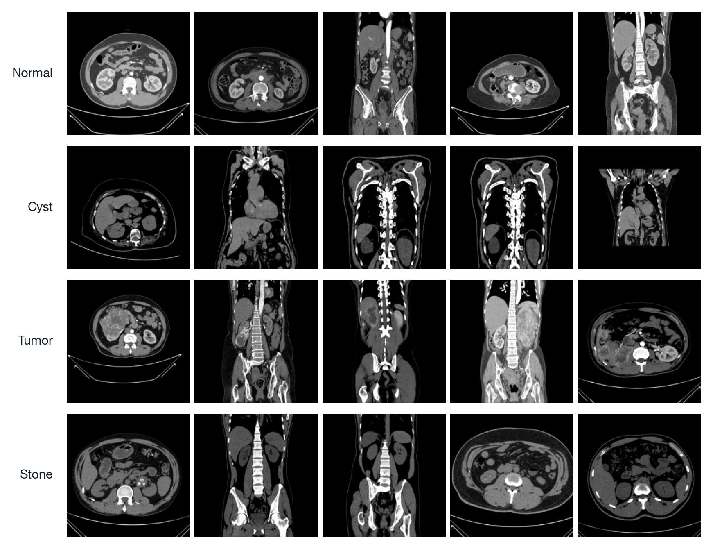
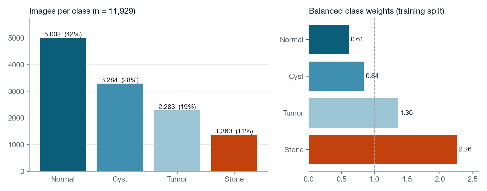
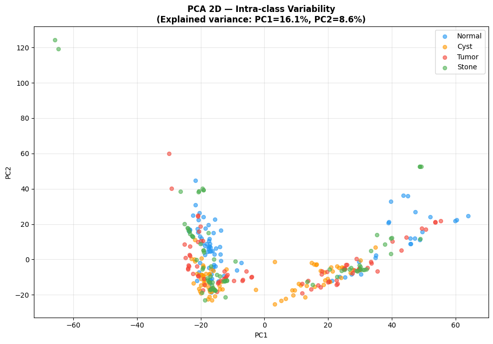

# Kidney CT: dataset audit and leakage-aware data splitting

Data-quality analysis that comes before training a classifier for **Normal / Cyst / Tumor / Stone** kidney CT images (University of Sydney, BMET5933).

*Five random images per class from the public CT-KIDNEY dataset. Axial and coronal reconstructions appear in every class. View is therefore a possible confounder to keep in mind during evaluation.*

## Problem

Public medical-imaging datasets often reach very high accuracy for the wrong reasons: near-duplicate slices from one patient end up in both training and test sets, classes are imbalanced, and acquisition differences correlate with labels. The goal was to measure these risks and produce a split and preprocessing plan that a later CNN or ViT comparison could trust.

## My contribution

- Built a reproducible inventory of 11,929 images, with class balance, image-size and colour-mode analysis, per-class intensity statistics and checks for corrupt or blank images.
- Ran exact-duplicate detection (MD5) and a lightweight perceptual-hash screen for near-duplicates.
- Produced a **group-aware stratified 70/15/15 split**, which infers patient or series groups from file names, plus integrity checks (no overlapping IDs, no missing paths) and a saved `dataset_split.csv`.
- Computed balanced class weights and wrote a `tf.data` loader and preprocessing pipeline for the split.

## Findings (documented in the notebook)

*Left: the dataset is imbalanced, with 3.7 times as many Normal images as Stone images. Right: balanced class weights computed on the training split, used to stop the model favouring the majority class.*

| Check | Result |
|---|---|
| Images (Normal / Cyst / Tumor / Stone) | 5,002 / 3,284 / 2,283 / 1,360 |
| Corrupt or near-blank images | 0 / 0 |
| Exact duplicates (MD5) | 0 |
| Dominant image size | 512 × 512 RGB; a minority of other sizes |
| PCA, first 2 components | 24.7% of variance; classes overlap heavily (below) |

*2-D PCA of downsampled pixels (80 images per class). The classes are not linearly separable in raw pixel space, and the two visible clusters contain all four classes. This motivates learned features over pixel-level heuristics.*

## Honest notes

- The perceptual hash flagged about 97% of images as near-duplicate candidates. That hash is too coarse to act on, so the screen is treated here as inconclusive. Only exact duplicates (none found) were removed.
- The split cell indexes 12,446 files, while the inventory counted 11,929 `.jpg` images. The 517-file difference has not been traced yet and must be reconciled before final training.

## Stack
Python · pandas · NumPy · scikit-learn · Pillow · seaborn/matplotlib · TensorFlow `tf.data`
