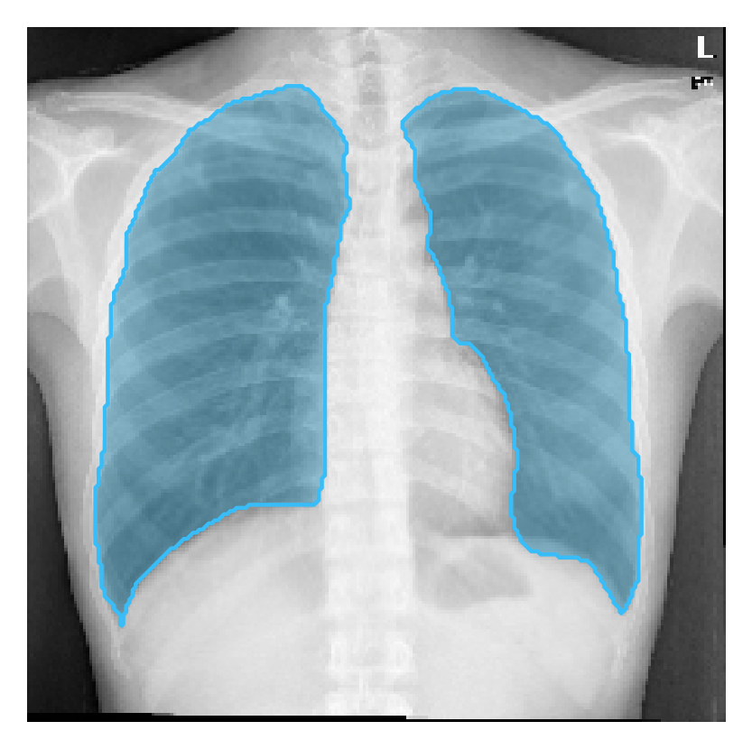
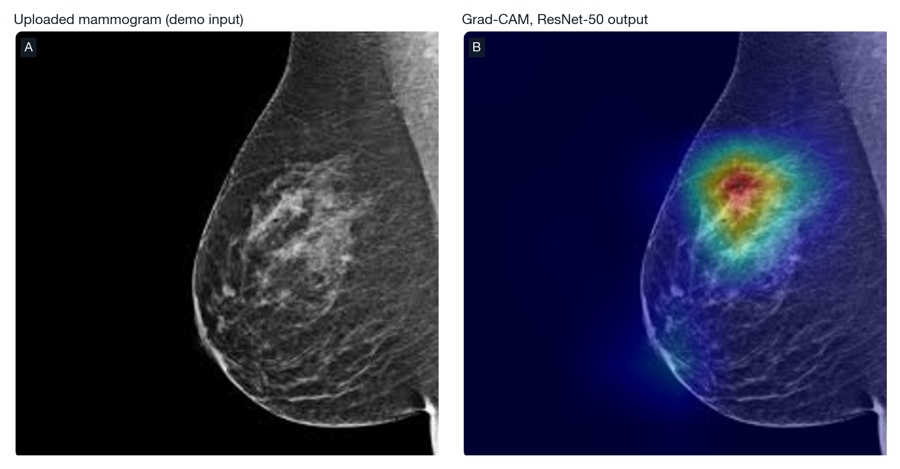
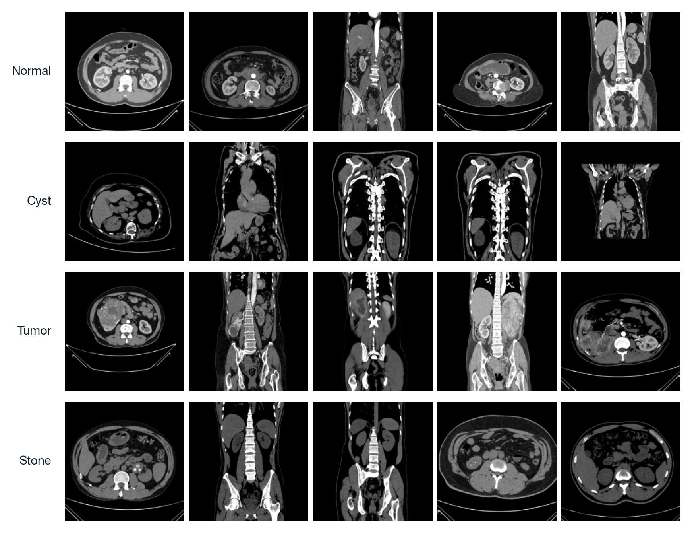

# Biomedical AI portfolio: Juan Camilo Rendón

Selected projects in **medical imaging, clinical decision support and applied machine learning**, with code, executed notebooks and the evidence behind each result.

**Portfolio site:** https://jcrendona.github.io/jcrendon.github.io/ · **CV:** [PDF](https://jcrendona.github.io/jcrendon.github.io/assets/documents/Juan_Camilo_Rendon_CV.pdf)

| | Project | Key documented result |
|---|---|---|
|  | **[Multi-task chest X-ray analysis](01-chest-xray-multitask/)**<br>Lung segmentation and thoracic-finding classification with shared encoders (DenseNet-121/U-Net, MobileNet), boundary-aware weights and TFRecord pipelines. | Mean ROC-AUC **0.822** over 13 findings on the CheXpert validation set (234 studies), from a weighted ensemble |
|  | **[OncoSight: breast cancer triage prototype](02-oncosight-breast-cancer/)**<br>Streamlit app that fuses mammography (ResNet-50 + Grad-CAM), SEER clinical risk and PCam histopathology with transparent late fusion. | Clinical module test ROC-AUC **0.866** (n = 604); mammography validation ROC-AUC 0.641, reported as a known limitation |
|  | **[Kidney CT dataset audit](03-kidney-ct-eda/)**<br>Data-quality, duplicate and imbalance analysis and a group-aware 70/15/15 split before a 4-class classifier. | 11,929 images audited; 0 corrupt, 0 exact duplicates; 3.7× class imbalance quantified |
| | **[Local LLM inference](04-llm-local-inference/)**<br>GPT-2 vs a quantised Llama-2-13B-chat running on one T4 GPU for domain Q&A. | Qualitative comparison; no fine-tuning |

## Principles used across projects

- **Only documented numbers.** Every metric comes from an executed notebook output or an exported `metrics.json`, and states the dataset, split and size it was measured on.
- **Limitations are stated.** Each README ends with honest notes: weak modules, label leakage that was found and excluded, and figures left out because they did not show what they claimed.
- **Reproducible figures.** `tools/build_figures.py` regenerates every figure from the notebooks and metric files in this repo.

## Repository layout

```
01-chest-xray-multitask/     notebooks/ · figures/ · README
02-oncosight-breast-cancer/  app/ (Streamlit) · docs/ · figures/ · README
03-kidney-ct-eda/            notebooks/ · figures/ · README
04-llm-local-inference/      notebooks/ · README
tools/                       build_figures.py · clean_notebooks.py · pdf2png.swift
```

Datasets (CheXpert, ChestX-ray14, Montgomery/Shenzhen, RSNA Mammography, SEER, PCam, CT-KIDNEY) are public and are **not** redistributed. Model weights are excluded from git (see each README).

## Rebuild the figures

```bash
swift tools/pdf2png.swift 02-oncosight-breast-cancer/docs/oncosight_demo_walkthrough.pdf build/onco 3   # macOS
python tools/build_figures.py
```

Code is released under the MIT License. Medical content is for research and education only.
